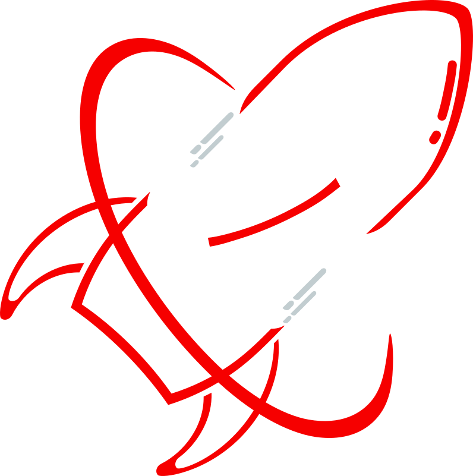

<p align="center">
  
</p>

<h1 align="center">Fusée Framework</h1>

<p align="center">
  <strong>v2.7.0 — Signals-First JS Framework | Atomic Reactivity | Rust Compiler | Go Toolchain</strong>
</p>

<br />

Fusée is a custom, high-performance fine-grained reactive JavaScript framework built for speed and simplicity. It features a recursive, non-greedy Rust compiler, a signals-based reactivity engine, fully integrated Dependency Injection support, file-based routing, and a fully self-contained Go CLI for instant application scaffolding — with an optional Go SSR engine for server-side rendering.

---

## What's New in 2.7.0

- Added **Web Components**: `defineElement()` turns a fusée component into a native custom
  element with reactive props synced to attributes, shadow DOM, scoped `css` styles, native
  slots and DOM events. `toCustomElement()` converts existing components.
- `provide()`/`inject()` work across custom elements, and interoperate with `@lit/context`
  through the Context Protocol.
- Server-side rendering of elements as declarative shadow DOM, in Node
  (`renderElementsSSR()`) and in the Go SSR engine (elements are read from `app/elements`
  by `npm run manifest`).
- Added `fusee generate element <tag-name>`.
- Fixed: delegated events (`@click`) inside shadow roots; the first `:binding` on a tag being
  ignored in string templates; content right after an `f-if` element being dropped by the
  compiler; manifest pages in the Go dev server not receiving their `Load` data;
  `fusee-framework` and `fusee-framework/server` failing to import in plain Node.

## What's New in 2.6.1

- Added package manager choice in the `fusee init` command and automatic installation
  of dependencies; (2.6.0)
- Added `--install` and `--skip-install` flags to the `fusee init` command; (2.6.0)
- Added `pm` flag to the `fusee init` command; (2.6.0)
- Updated dev dependency for vite babel plugin. (2.6.1)

## Quick Start

The fastest way to get started with Fusée is via the **Go-Powered CLI**:

```bash
# Install globally from npm
npm install -g fusee-framework

# Scaffold a new project (JS or TS)
fusee init my-app

# Or use the binary directly
create-fusee-app init my-app
```

Follow the interactive prompt to choose **JavaScript** or **TypeScript**, then:

```bash
cd my-app && npm install

# Start in SPA mode (no Go required)
npm run dev:spa     # → Vite dev server on port 5173
```

---

## CLI Commands

The `fusee` CLI is a single self-contained binary (no Node.js runtime needed) compiled for all platforms.

### `fusee init <name>`

Scaffold a new Fusée project. Includes the full framework core, file-based routing, Vite config, and sample pages.

```bash
fusee init my-app           # JavaScript template
fusee init my-app --ts      # TypeScript template
```

### `fusee generate <type> <name>`

Generate boilerplate for common resource types:

```bash
fusee generate page    dashboard   # → app/pages/dashboard.js
fusee generate component Button    # → app/components/Button.js
fusee generate store   auth        # → app/stores/auth.js
fusee generate composable useFetch # → app/composables/useFetch.js
fusee generate action  sendEmail   # → app/actions/sendEmail.js
fusee generate element fu-counter  # → app/elements/fu-counter.js (custom element; needs a hyphen)
```

Aliases: `fusee g page dashboard`, `fusee g el fu-counter`

### `fusee add server`

Install the optional **Go SSR Engine** into an existing project:

```bash
cd my-app
fusee add server        # → installs framework/engine-go
npm run dev             # → generate manifest + start Go server on port 3000
```

Aliases: `fusee add go-server`, `fusee add engine-go`

### `fusee add frel`

Install the optional **FREL (Fusée Reactive Expression Language)** module into an existing project:

```bash
cd my-app
fusee add frel        # → installs framework/frel
```

FREL adds support for LINQ-style reactive queries over arrays, iterables, and signals, as well as client-side server function execution.

---

## Example Component

```javascript
// default template

export const Counter = defineComponent({
  setup() {
    const count = signal(0);
    const double = computed(() => count() * 2);

    return {
      count,
      double,
      inc: () => count(count() + 1),
      template: `
        <div class="card">
          <h2>Count: {{ count }}</h2>
          <button @click.debounce.300ms="inc">Increment</button>
          <p f-if="count() > 0">Double: <strong>{{ double }}</strong></p>
        </div>
      `,
    };
  },
});
```

```jsx
// jsx template

export const Counter = defineComponent({
  setup() {
    const count = signal(0);
    const double = computed(() => count() * 2);

    return {
      count,
      double,
      inc: () => count(count() + 1),
      render() {
        return (
          <div className="card">
            <h2>Count: {count()}</h2>
            <button onClick={this.inc}>Increment</button>
            {count() > 0 && (
              <p>
                Double: <strong>{double()}</strong>
              </p>
            )}
          </div>
        );
      },
    };
  },
});
```

---

## Web Components

`defineElement()` registers a native custom element backed by a fusée component. It works in
plain HTML, inside fusée templates and JSX, and in any other framework.

```javascript
import { defineElement, css } from 'fusee-framework'

defineElement('fu-counter', {
  props: {
    count: { type: Number, default: 0, reflect: true },   // <fu-counter count="3">
    items: { type: Array, default: () => [], attribute: false }, // property only
  },
  styles: css`:host { display: block } button { padding: ${8}px }`,
  shadow: 'open', // 'open' (default) | 'closed' | false (light DOM)
  setup(props, { host, emit }) {
    return {
      props,
      inc: () => { host.count = props.count + 1; emit('change', host.count) },
      template: `<button @click="inc">{{ props.count }}</button><slot></slot>`,
    }
  },
})
```

- **Props** are signals exposed as element properties. Attributes are converted by type
  (`String`, `Number`, `Boolean`, JSON for `Array`/`Object`), use kebab-case names
  (`userName` ↔ `user-name`), and can be customized with `attribute` and `converter`.
  `reflect: true` writes changes back to the attribute. Updates are fine-grained: setting
  `el.count = 5` only touches the nodes that read it.
- **Binding from fusée:** `:items="list"` in string templates and `items={list()}` in JSX
  set rich values as properties, so arrays and objects arrive intact.
- **Events:** `emit(name, detail)` dispatches a bubbling, composed `CustomEvent` from the
  host. Listen with `@change="onChange"` or `addEventListener`.
- **Styles:** `css` builds one stylesheet shared by every instance. Interpolations must be
  `css` results or numbers; use `unsafeCSS()` for trusted strings.
- **Lifecycle:** `setup` runs on first connect, `onMount`/`onUnmount` work as usual, and
  moving an element in the DOM keeps its state.
- **DI:** `provide()`/`inject()` reach across element boundaries. Fusée also speaks the
  community Context Protocol, so it can consume `@lit/context` providers and serve Lit
  consumers.
- **Existing components:** `toCustomElement(Counter, 'fu-counter')` registers a
  `defineComponent()` component as an element.

Elements in `app/elements/` (created by `fusee generate element <tag-name>`) are registered by
`app/main` in new projects. For projects created before 2.7, add this line once to `app/main`:

```javascript
import.meta.glob('./elements/**/*.{js,ts}', { eager: true })
```

### Server-side rendering

Elements render on the server as declarative shadow DOM (`<template shadowrootmode>`), so
their content and styles are visible before JavaScript loads. On upgrade, the element takes
over that shadow root.

- **Node:** pass any HTML (a compiled page, a static file) through `renderElementsSSR()`:

  ```javascript
  import { renderElementsSSR } from 'fusee-framework/server'

  const html = await renderElementsSSR(pageHtml)
  ```

- **Go engine:** `npm run manifest` also imports the modules in `app/elements/` and adds each
  element's props, styles and template to `.fusee/manifest.json`. The Go server renders them
  automatically. Go cannot run JS `setup()`, so templates see props directly and as
  `props.x`. For computed state, attach a Go `Setup` function:

  ```go
  elements := manifest.ElementRegistry()
  elements["fu-greet"].Setup = func(props evalexpr.Scope) (evalexpr.Scope, error) {
      return evalexpr.Scope{"greeting": "Hello, " + props["name"].(string)}, nil
  }
  html, err := engine.RenderWithElements(page.AST, scope, nil, elements)
  ```

Element modules must be importable in plain Node for SSR (no CSS or browser-only imports at
module level). Light-DOM elements (`shadow: false`) render on the client only, and slot
fallback content appears once the element upgrades.

---

## Development Modes

| Mode                | Command            | Port | Requires Go |
| ------------------- | ------------------ | ---- | ----------- |
| SPA (Vite)          | `npm run dev:spa`  | 5173 | ❌          |
| SSR (Go server)     | `npm run dev`      | 3000 | ✅          |
| Regenerate manifest | `npm run manifest` | —    | ❌          |
| Production build    | `npm run build`    | —    | ❌          |

> **SSR mode** requires Go 1.22+ (`https://go.dev/dl/`) and running `fusee add server` first.

---

## Go SSR Engine (`engine-go`)

The Go SSR engine is a decoupled, optional package — **not bundled** at project init. Install it when you need server-side rendering:

```bash
fusee add server
```

Once installed at `framework/engine-go`, it:

- Reads `.fusee/manifest.json` (generated by `npm run manifest`) for route discovery
- Renders components server-side and hydrates them in the browser
- Serves static assets and handles client-side navigation

The engine is a standalone Go module and can also be used independently of the CLI.

---

## FREL (Fusée Reactive Expression Language)

FREL provides LINQ-style queries over arrays, iterables, and signals — all while maintaining fine-grained reactivity. It can be available by installing it from the cli using `fusee add frel`.

```typescript
import { from, toSignal } from "./framework/frel/frel.js";

// Reactive queries over arrays, iterables, and signals
const users = [
  { id: 1, name: "A" },
  { id: 2, name: "B" },
];
const filtered = toSignal(
  from(users)
    .where((u) => u.id > 1)
    .orderBy((u) => u.name),
);

filtered(); // [{id:2, name:"B"}]
```

---

## Comet HTML-Over-the-Wire Module

Comet keeps interactive behavior close to HTML and HTTP. Elements can issue requests,
send form values, and replace a selected part of the page with the returned HTML without
requiring a client-side router or a large client-side state layer.

The browser module uses `comet-*` attributes:

```html
<button
  comet-get="/notifications"
  comet-target="#notifications"
  comet-swap="innerHTML"
>
  Refresh notifications
</button>

<form comet-post="/profile" comet-target="#profile">
  <input name="displayName" />
  <button type="submit">Save</button>
</form>
```

Supported request attributes include:

- `comet-get`, `comet-post`, `comet-put`, `comet-patch`, and `comet-delete`
- `comet-trigger` for events such as `click`, `submit`, `change`, `load`, and polling with `every`
- `comet-target` and `comet-swap` for selecting the target and controlling the DOM update
- `comet-vals` and `comet-include` for adding request values
- `comet-indicator` for loading-state styling and `comet-confirm` for confirmation prompts
- `comet-push-url` for updating browser history
- `comet-swap-oob` for updating additional page regions outside the main target

Comet dispatches lifecycle events including `comet:beforeRequest`, `comet:afterRequest`,
`comet:beforeSwap`, `comet:afterSwap`, `comet:responseError`, and `comet:sendError`.
Handlers can cancel a request or a swap with `preventDefault()` and can inspect the
request, response, target, and swap details from the event.

Comet requests include metadata headers so the Go server can distinguish a fragment
request from a normal page request. The Go integration provides response helpers:

```go
if comet.IsComet(r) {
    comet.Retarget(w, "#content")
    comet.Reswap(w, "outerHTML")
    comet.PushURL(w, "/profile")
}
```

The server can also use `comet.Redirect(w, "/login")`. Comet understands server response
headers for retargeting, reswapping, redirects, and history updates, and supports
fragment-aware rendering so the same route can return a focused HTML fragment for Comet
requests or a complete document for a normal browser visit.

The browser implementation lives in `framework/core/comet-js/`, while the Go helpers live
in `framework/engine-go/comet/`.

---

## File-Based Routing

Drop a file in `app/pages/` and it becomes a route automatically:

```
app/pages/
  _layout.js        → wraps all pages
  index.js          → /
  about.js          → /about
  blog/[slug].js    → /blog/:slug  (dynamic)
```

Generate pages instantly:

```bash
fusee generate page contact     # → app/pages/contact.js
```

---

## Build-Time Template Compiler

Fusée compiles HTML templates into optimized virtual DOM calls at build time via the `fuseeCompilerPlugin` for Vite — zero runtime parsing overhead.

**Template file** (`Welcome.template.html`):

```html
<div class="card">
  <h2>Hello, {{ name }}!</h2>
  <input f-model="name" placeholder="Type a name..." />
  <button @click="increment">Clicked {{ count }} times</button>
  <p f-if="count() > 0">Double: <strong>{{ double }}</strong></p>
</div>
```

**Component file** (`Welcome.js`):

```javascript
import { render } from "./Welcome.template.html";

export const Welcome = defineComponent({
  render,
  setup() {
    const name = signal("World");
    const count = signal(0);
    const double = computed(() => count() * 2);
    return { name, count, double, increment: () => count(count() + 1) };
  },
});
```

---

## Key Features

- **Go-Powered CLI** — Blazing-fast scaffolding with cross-platform binaries (Windows, Linux, macOS Intel/ARM)
- **Optional Go SSR Engine** — Decoupled server package, install only when needed
- **Optional Comet Module(HTML-Over-the-Wire)** — Keep interactive behavior close to HTML and HTTP
- **Signals-First Reactivity** — Atomic fine-grained updates, only modified DOM nodes touched
- **File-Based Routing** — Nuxt-style automatic route discovery with layout support
- **Rust WASM Build-Time Compiler** — Recursive hybrid compiler + optional Rust WASM backend for peak throughput
- **Directives support** — `f-if`, `f-for`, `f-model`, `f-text`, `f-cloak`, `f-once`, `@event` modifiers
- **Web Components** — `defineElement()` builds native custom elements with reactive props, shadow DOM, scoped styles and SSR (declarative shadow DOM) in Node and Go
- **Dependency Injection** — Nested `provide`/`inject` with shadowing, across custom elements and with `@lit/context` interop
- **Composables & Stores** — Reactive state management patterns baked in
- **Server Actions** — Type-safe RPC-style functions for client→server communication
- **Full TypeScript Support** — Comprehensive `.d.ts` types for all framework primitives
- **Vite Integration** — Full HMR support and production build pipeline
- **Memory Safety** — Automatic effect disposal and explicit leak checks
- **Custom Plugins API** — Vue-style `app.use()` hooks for shared extensions

---

## Project Structure

A scaffolded Fusée project:

```
my-app/
├── app/
│   ├── pages/          # File-based routes (_layout, index, about, ...)
│   ├── components/     # Reusable UI components
│   ├── stores/         # Reactive state stores
│   ├── composables/    # Reusable logic hooks
│   ├── actions/        # Server actions
│   └── elements/       # Custom elements (defineElement)
├── framework/          # Fusée core engine (injected by CLI)
│   ├── core/           # Reactivity, compiler, directives, DI
│   ├── router/         # Client-side router
│   ├── server/         # Manifest generator & dev helpers
│   ├── types/          # TypeScript definitions
│   └── (*) engine-go/  # Go SSR engine (optional, fusee add server)
├── .fusee/             # Runtime manifest (generated)
├── index.html
├── vite.config.js
└── package.json
```

---

## TypeScript Support

Full type definitions are available for all framework primitives:

```typescript
import type {
  Signal,
  Computed,
  Component,
  Router,
  ServerAction,
} from "./framework/types";
```

Core auto-imports are declared in `framework/auto-imports.d.ts`. Application-owned services, components, stores, actions, router APIs, utilities, and types should be imported explicitly.

---

## Comet

Fusee SSR module has a special package too - Comet: a HTMX-style package which is intended to be used in SSR-only builds to swap html content without a full page reload. It uses the same reactivity engine as the core engine, so you can use signals, computed, and effects in your Comet components too.

It can be installed from the CLI after installing the SSR engine (default: not installed).

## Performance Benchmarks

Framework Total Mean (Create, Update, Swap, Clear tests)
Compared to other popular JS Frameworks:

|  Rank  | Framework              | Execution Time |
| :----: | :--------------------- | :------------: |
| **1**  | **Qwik**               |   117.55 ms    |
| **2**  | <mark>**Fusée**</mark> | **120.30 ms**  |
| **3**  | **Angular**            |   121.29 ms    |
| **4**  | **Solid**              |   121.54 ms    |
| **5**  | **Preact**             |   123.18 ms    |
| **6**  | **Vue**                |   123.99 ms    |
| **7**  | **Svelte**             |   125.15 ms    |
| **8**  | **React**              |   126.12 ms    |
| **9**  | **Mithril**            |   128.35 ms    |
| **10** | **Lit**                |   131.08 ms    |

---

## Building the CLI

The CLI, being cross-platform for windows, linux, mac-arm64 and mac-intel, is built from source using the included `build-cli.mjs` script:

```bash
node bin/build-cli.mjs
```

Output: `bin/create-fusee-{win.exe,linux,mac-arm64,mac-intel}`

---

## Testing

```bash
npm test
npx vitest --reporter=verbose
npx vitest # watch mode
```

**740 tests passing.** Coverage includes: reactivity engine, component lifecycle, DI, directives, events, memory safety, TypeScript types, and integration scenarios.

---

## Roadmap

- [x] Go-powered CLI with cross-platform binaries
- [x] Optional Go SSR engine (`fusee add server`)
- [x] File-based routing with layout support
- [x] Build-time HTML template compiler
- [x] Rust WASM compiler backend
- [x] Comprehensive TypeScript definitions
- [x] Generators for pages, components, stores, composables, actions
- [x] JSX/TSX Support
- [x] Web Components (`defineElement`) with SSR and `fusee generate element`
- [ ] Production SSR build pipeline
- [ ] Plugin system for third-party extensions

---

Built by Sebi Somu — a forward-thinking JavaScript Architect.
